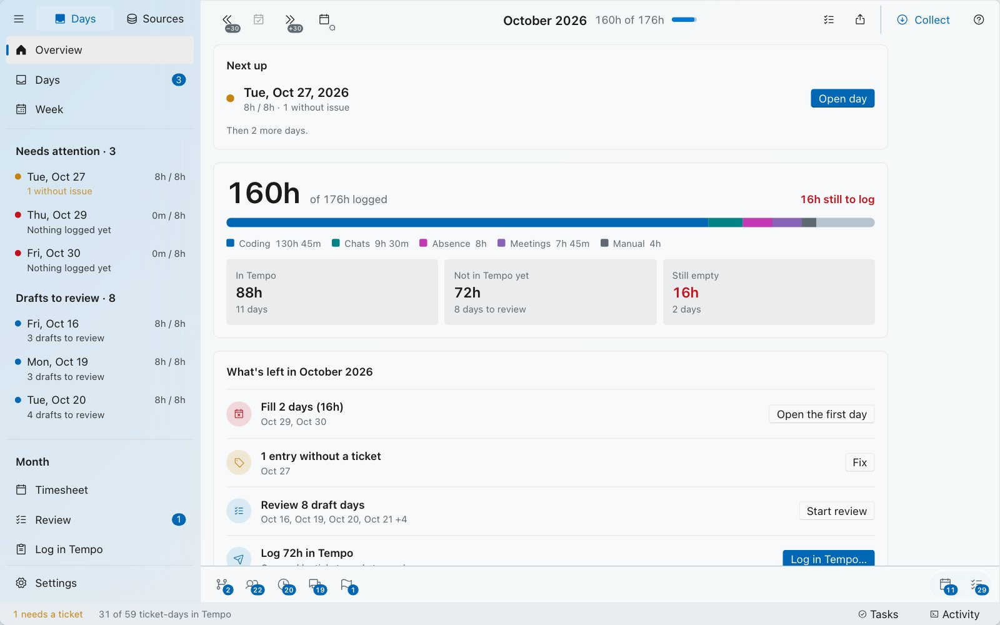

# WorkLogger

Month-end worklogs from your git commits, calendar meetings and chats, sent to Tempo.

WorkLogger reads what you already left behind during the month (commits in your repositories, meetings in your
calendar, conversations in Google Chat, the hours your HR system recorded) and turns each day into draft worklogs on
the right Jira tickets. You review the drafts, fix what it guessed wrong, and send them to Tempo or Jira in one go,
or copy them as a checklist and log them by hand.



It runs on **macOS, Windows and Linux**, in English and Hungarian. Everything stays on your computer.

## What it reads

| Module | Source | What becomes a worklog |
| --- | --- | --- |
| Repositories | your local git repositories | commits, estimated from their size and the time between them, grouped by ticket |
| Meetings | Google Calendar, or an ICS calendar feed | each meeting, at its real time and length |
| Work sessions | HRmaster | your recorded working hours, so each day adds up to what HR has |
| Chats | Google Chat | longer stretches of chatting, logged to the conversation's ticket |

Turn on only the modules you need. Tickets come from the commit message or branch name, rules you set per
repository, project, meeting title or chat, and project periods that book whole days to one ticket.

## Install

Download the package for your system from the [Releases](https://github.com/molnarroland/WorkLogger/releases) page.
Each release lists SHA-256 checksums in `SHA256SUMS.txt`.

The builds are **not code-signed** yet, so your system will warn you the first time:

- **macOS** (`…-macos-universal.zip`, Apple silicon and Intel, macOS 26 or later): unzip and move `WorkLogger.app` to
  Applications. Open it once; when macOS refuses, go to **System Settings → Privacy & Security** and choose
  **Open Anyway**. Or, in Terminal: `xattr -dr com.apple.quarantine /Applications/WorkLogger.app`.
- **Windows** (`…-windows-amd64-setup.zip`): unzip it and run the setup `.exe`. When SmartScreen says it protected
  your PC, choose **More info → Run anyway**. The installer adds the WebView2 runtime if it is missing.
- **Linux** (`.AppImage`, `.deb` or `.rpm`): needs WebKitGTK 6.0 (`libwebkitgtk-6.0-4` on Debian and Ubuntu,
  `webkitgtk6.0` on Fedora). For the AppImage: `chmod +x WorkLogger-*.AppImage` and run it. Tokens are stored
  through the Secret Service, so a keyring (GNOME Keyring, KWallet) must be running.

## Getting started

The first start opens a short guide: choose your modules and how you log time in Tempo. Then add what the
modules need under **Settings → Profiles** and **Repositories**: your Jira site and API token, a Tempo token if
WorkLogger should send worklogs for you, your commit email, and the folders that hold your repositories.

At the end of a month: **Collect**, look through the days that need attention, give the leftovers a ticket, mark
the drafts reviewed, and **Export**.

## Your data

- **Local database:** one SQLite file, `WorkLogger/worklogger.sqlite` in your user config folder
  (`~/Library/Application Support` on macOS, `%AppData%` on Windows, `~/.config` on Linux).
- **Tokens** (Jira, Tempo, Google) are kept in the system keyring, never in the database. The app starts locked
  and reads the keyring only when you unlock it.
- **Network:** WorkLogger only connects to the services you set up: your Jira site, Tempo (`api.tempo.io` or
  `api.eu.tempo.io`), Google (Chat, and Calendar if you use it), your HRmaster site, and the calendar feed URLs you
  add. There is no telemetry or analytics. The activity console (status bar → **Activity**) lists every request
  and git command, with credentials masked; chat message text is never written there.

## Good to know

WorkLogger grew out of one team's month ends. Some parts are general, some are not:

- **Work sessions need HRmaster**, a Hungarian HR product. Without it, a day's target is a fixed number of hours
  (8 by default).
- **Google Chat, and Google Calendar without the API, are read from Google's signed-in web pages**, in an app
  window where you sign in once. This depends on how Google builds those pages, so it can stop working when Google
  changes them, and automated reading of these pages may not be what Google's terms intend. It is your account: use
  it if that is acceptable to you.
- **Google Calendar through the API** needs your own OAuth client ID and secret from a Google Cloud project.
- **Calendar feeds (ICS)** work with IANA time zone names (`Europe/Budapest`) and common repeat rules (daily,
  weekly on given days, monthly, yearly, with interval, count, end date and exceptions). Outlook's Windows zone names
  fall back to your local zone, and rules such as "the second Tuesday" (`BYSETPOS`, ordinal `BYDAY`, `BYMONTHDAY`
  lists) are not expanded, so some meetings from such feeds may be missing or at the wrong time.
- **Wails** is pinned to `v3.1.0`.

## Build from source

You need Go 1.26 or later (it fetches the pinned 1.27.4 toolchain), Node 24, [Task](https://taskfile.dev) and the Wails CLI
(`go install github.com/wailsapp/wails/v3/cmd/wails3@v3.1.0`). On Linux, also the GTK 4 and WebKitGTK 6.0
development packages.

```sh
git clone https://github.com/molnarroland/WorkLogger.git
cd WorkLogger
task build        # the app in bin/
task package      # an installable package for this OS
task dev          # run with live reload
task check        # formatting, lint and tests
```

The Go code embeds the built frontend (`frontend/dist`), so build the frontend first (`task build` does) before
running `go build` or `go test` by hand.

See [CONTRIBUTING.md](CONTRIBUTING.md) for how the code is organised, and
[docs/ARCHITECTURE.md](docs/ARCHITECTURE.md) for how it works and its trust boundaries. Security issues:
[SECURITY.md](SECURITY.md).

## Licence

[MIT](LICENSE)
