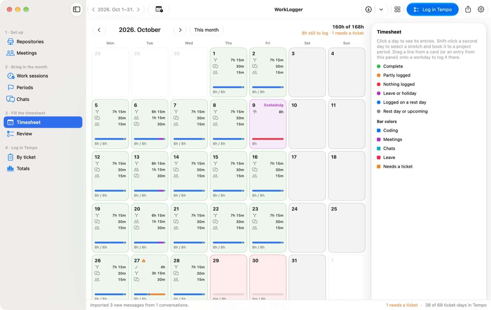
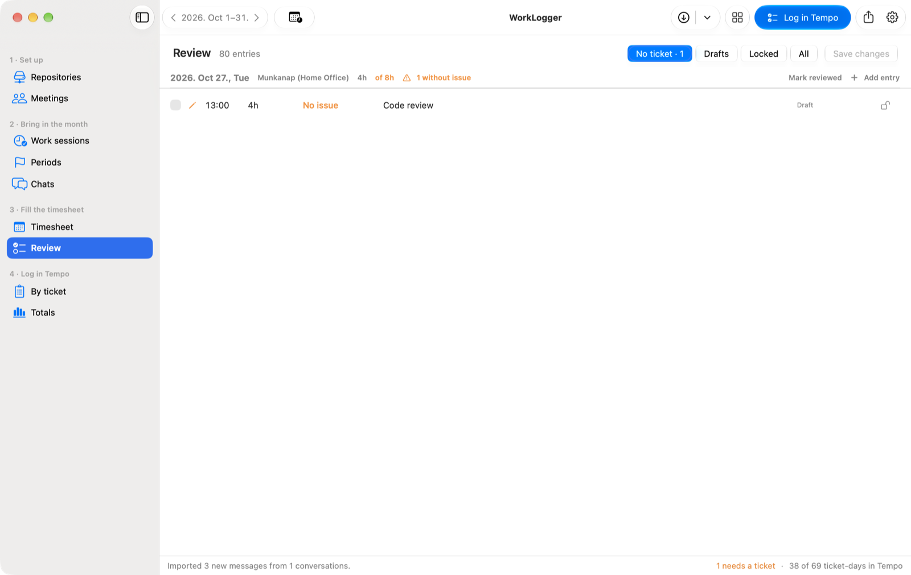
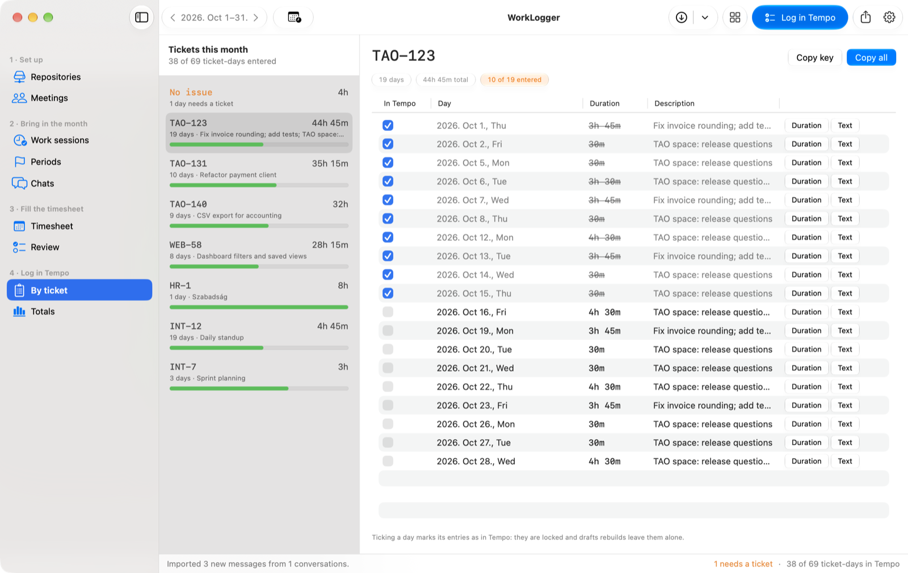
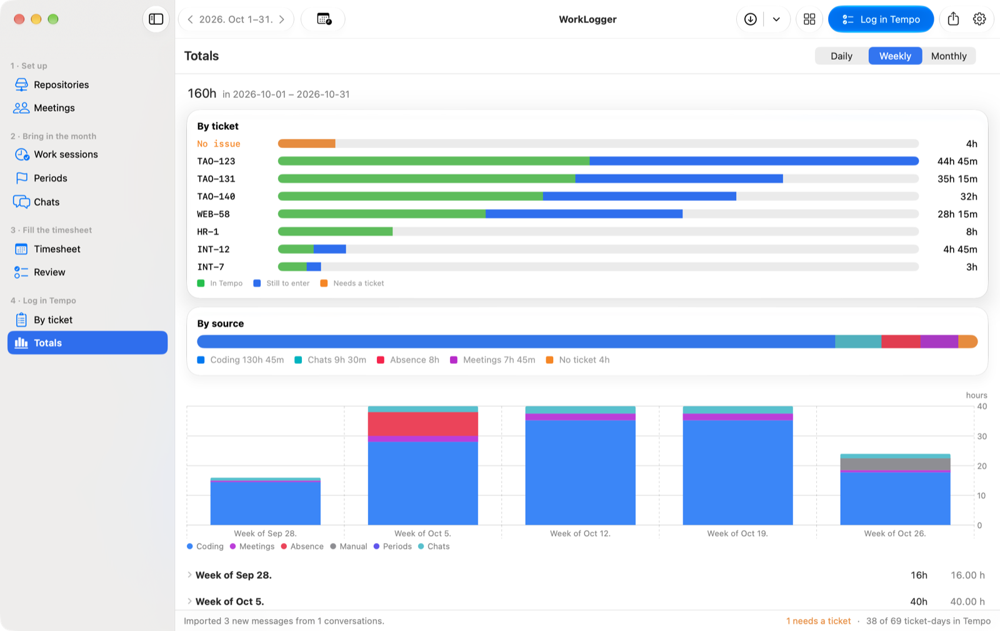
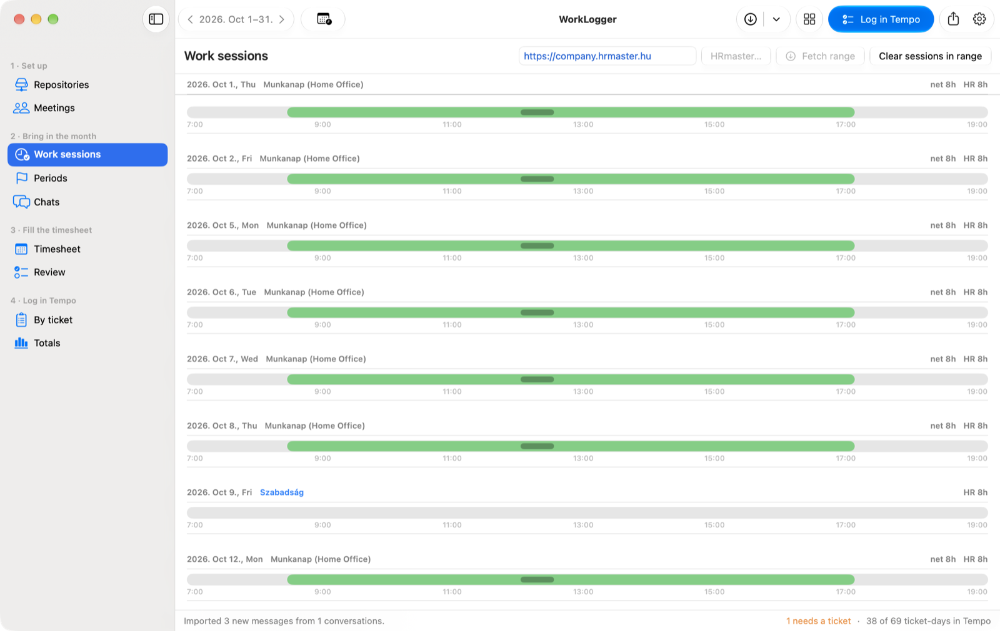
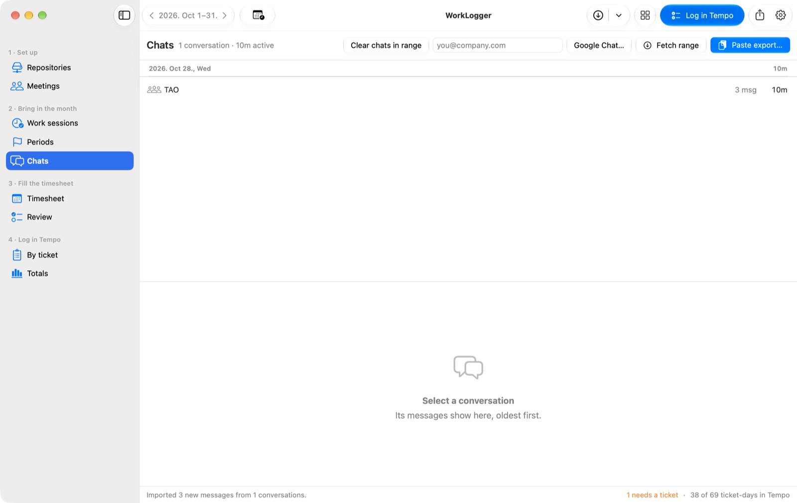
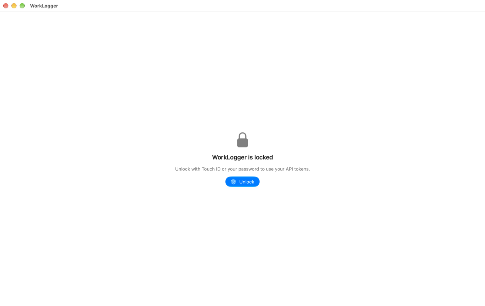

# ⏱ WorkLogger

**Your month already happened. WorkLogger writes the timesheet for it.**

A native macOS app that turns your git commits, calendar meetings, chats and HR work times into a reviewed
timesheet, then helps you log it in Tempo or Jira, by hand, through the API or with Claude.

## Why

Booking time is the part of the job nobody became a developer for. At the end of the month you scroll through
`git log`, your calendar and a chat history, guess how long each thing took, then type it ticket by ticket into
Tempo. It is slow and error-prone, and it is always late.

WorkLogger does the remembering for you. It reads what you actually did, estimates the time for each piece of work,
fits it into the hours you really worked, and hands you a timesheet to check. You decide what goes in. WorkLogger
only does the typing.

### Who it's for

* **Developers** who log time to Jira tickets: commits become worklogs on the ticket in the commit message or branch.
* **Tech leads and managers** whose day is meetings and chats: calendar events and chat conversations become
  worklogs too, with rules such as `standup → INT-12`.
* **Contractors and consultants** working for several clients: one Jira account per site, each with its own
  worklog system, and every issue goes to the site that owns its project.
* **Teams with an HR system** (HRmaster): the days and hours HR has on record set the target, so the timesheet
  and the payroll agree.

## Features

| | |
|---|---|
| 🧠 **Commit time estimates** | From the gap since your previous commit and the size and kind of each change, fitted into your working hours. |
| 📅 **Meetings** | Any calendar macOS syncs (Google, Exchange/Outlook, iCloud, CalDAV), read-only, with rules that map meetings to tickets. |
| 💬 **Chats** | Google Chat conversations are read day by day and turned into stretches of chatting you can log. |
| 🕘 **Work times** | HRmaster sessions, breaks, leave and holidays set each day's target. Leave days are logged to an absence issue. |
| 🗓 **Timesheet** | A Tempo-style month grid: complete, partly logged, nothing logged, leave. Drag entries between days. |
| ✅ **Review** | Edit any entry inline. Edited entries lock, so rebuilding the drafts never overwrites your changes. |
| 🎯 **Periods** | Book a stretch of days (a migration, a release) to one ticket in two clicks. |
| 🎫 **By ticket** | Every ticket with its days and durations, ready to copy into Tempo, with a tick-off list. |
| 🏢 **Several Jira accounts** | Each site has its own sign-in and worklog provider: **Tempo**, **Jira (Log work)** or **another tool**. Project keys are read from Jira to route each issue, with a default account for the rest. |
| 🔁 **Read-back** | What is already logged in Tempo or Jira shows next to your entries, so nothing is booked twice. |
| 🤖 **Claude checklist** | Export a Markdown checklist that Claude in Chrome follows to fill your Tempo timesheet. |
| 📤 **Export** | Send through the API, or save CSV (Tempo importer) and JSON. |
| 🔐 **Locked at launch** | API tokens are kept in one Keychain item and opened only on **Unlock**, with Touch ID or your password. |
| 🍏 **Native and private** | SwiftUI with Liquid Glass, a menu bar clock, keyboard shortcuts, English and Hungarian. Your data stays in a local SQLite file. |

## Screenshots

<table>
<tr>
<td width="50%"> <b>Review</b>: every entry by day, editable inline, with what is already in Tempo.</td>
<td width="50%"> <b>By ticket</b>: the days and durations to enter per ticket, ticked off as you go.</td>
</tr>
<tr>
<td> <b>Totals</b>: hours per ticket (entered vs. still to enter), per source and per week.</td>
<td> <b>Work sessions</b>: the hours HR has on record, which set each day's target.</td>
</tr>
<tr>
<td> <b>Chats</b>: conversations turned into stretches of chatting you can log to a ticket.</td>
<td> <b>Locked at launch</b>: one Touch ID prompt opens your API tokens.</td>
</tr>
</table>

Screenshots use sample data. A debug build makes them: `WorkLogger -WLScreenshots docs/screenshots` (see Notes).

## Run it

Requires macOS 26+ (Liquid Glass) and Xcode 26+. There are no third-party dependencies: the app uses the system
SQLite, Charts and Network frameworks.

Open `WorkLogger.xcworkspace` in Xcode and press ⌘R. ⌘U runs every test (the app's and each WorkLoggerKit module's,
through the `WorkLogger.xctestplan` test plan). Opening `WorkLogger.xcodeproj` alone still builds and runs the app,
but its ⌘U only runs the app's tests. Every view has a `#Preview` backed by sample data
(`Support/PreviewData.swift`, throwaway database).

**Install:** Product → Archive. The scheme's archive post-action copies the signed app to
`/Applications/WorkLogger.app` (replacing the previous one) and registers it, so macOS keeps one WorkLogger with its
calendar permission and Dock icon. From Terminal: `xcodebuild archive -workspace WorkLogger.xcworkspace -scheme WorkLogger`.
`swift run` still starts the app for a quick look (no translations or icon).

Data lives in `~/Library/Application Support/WorkLogger/worklogs.sqlite`. Tokens are in the Keychain, in one item
that is read only after **Unlock** (Touch ID or your password). With an ad-hoc signed build, macOS may also ask once for
the keychain password after each rebuild; **Always Allow** keeps it quiet until the next build.

## Workflow

1. **Repositories** – choose your workspace folder; every git repo below it (4 levels deep) is listed.
   Enter your commit email(s). Optionally give a repo a default issue (`TAO-17`) or a project (`TAO`).
   Projects get a catch-all issue, because Tempo can only log to issues.
2. **Work sessions** – enter your company's HRmaster address, sign in once in the HRmaster window, then choose
   **Fetch range**: each month's Munkaidő calendar is read in the background. Breaks and the gaps between sessions
   are not working time.
3. **Calendar** – add your calendar account (see below) and add rules such as `standup → INT-12`.
4. **Timesheet** – Tempo-style month grid: each day shows logged vs. expected hours (green complete, orange partly,
   red nothing, purple leave). Click a day for its entries; shift-click a second day to mark the stretch as a period.
5. **Periods** – book a stretch of days to one issue for a larger project: commit time and the rest of each workday
   go to that issue (meetings keep theirs, leave is never filled). Rebuild drafts after changes.
6. **Review** – pick a range and choose **Collect**. Edit start, duration, issue or description inline.
   Edited entries lock automatically, so **Rebuild drafts** (after changing settings or sessions) keeps them.
7. **Chats** – sign in to Google Chat once in its window, then **Fetch range** reads your messages and mentions day
   by day; log a conversation's active time to a ticket.
8. **Log in Tempo → By ticket** – every ticket with the days and durations to enter; copy them into Tempo and tick
   each day off. **Totals** shows hours per ticket (entered vs. still to enter) and per source.
9. **Export** (toolbar) – copy or save a Markdown checklist that Claude with Claude in Chrome follows to fill your
   Tempo timesheet, send through the API of each issue's Jira account (Tempo or Jira worklogs), or save CSV / JSON.

## How times are calculated

Per day:

* **Working time** = imported work sessions − breaks (or the default workday when nothing was imported).
* **Meetings** keep their real slot and length (rounded to the granularity). Declined, all-day,
  out-of-office and focus-time events are ignored; you can untick any meeting.
* **Commits** get an estimate: `0.6 × free working minutes since your previous commit + 0.4 × complexity`,
  where complexity = `10 + 12·log2(1 + changed lines/10) + 4·files`, adjusted by the kind of change
  (refactor ×1.3, fix ×1.15, typo/bump/format ×0.5), clamped to min/max. Lockfiles, `vendor/`, `dist/`… are excluded.
* Commits are grouped per issue (or per repo when no key is found) into one entry with their subjects as description.
* **Daily total** – the time worked according to the imported sessions (HRmaster's “Ledolgozott órák”), rounded
  up to 15 minutes by default (7h 22m → 7h 30m, 12h → 12h); days without sessions use the hours per day (8h). Or keep
  raw estimates. Scaling uses the largest-remainder method on the rounding unit, so each day adds up exactly.
  Meetings and locked/manual entries are subtracted first; commit entries are placed into the remaining free slots.

Issue key resolution for commits: key in message → key in branch name (`feature/tao-123-…`) → repo default
issue → project catch-all issue. Unresolved entries are highlighted and never exported.

## HRmaster import

**Fetch range** on the Work sessions page opens `…/Datacenter/#/employeeWorkingTime/own` in the signed-in HRmaster
session, steps the month arrows to each month of the range and parses the Munkaidő panel. HRmaster's login cookies
are kept for 14 days, but HRmaster itself ends idle sessions after about 25 minutes; a fetch then asks you to sign in.
The parser reads the page through its `data-e2e-testing` attributes:

| What | Where it comes from |
| --- | --- |
| Month | period header, e.g. “2026. március” (falls back to the selected range's month) |
| Day type | `Type_CalendarDayStatus_*`: Workday, RestDay, PublicHoliday, LabourCode (leave) |
| Day label | e.g. “Munkanap (Home Office)”, “Szabadság”, “Pihenőnap” |
| Work sessions | Munkaidő 1–n columns (From/To) |
| Breaks | Szünet 1–n columns, subtracted from the sessions |
| Check totals | “Ledolgozott órák”; Work sessions shows it next to the net time and marks a mismatch orange |

The HR day type decides the daily target, so transferred Saturday workdays count as workdays and weekday
holidays or leave never get filled with commit time. With an absence issue set (Settings → Absences), leave days
are logged with the hours HRmaster reports; label rules can send e.g. “Betegszabadság” to a different issue.
Leave days get only that one entry (meetings are not logged); commits made on a leave day are logged on the closest
workday (the earlier one on a tie), even when that day is just outside the selected range.
Commits on a weekend or other rest day without imported work sessions move the same way: Saturday → Friday,
Sunday → Monday. A rest day with work sessions keeps its commits.
The day's target is HRmaster's “Ledolgozott órák”, rounded up (Settings → Round worked time up to).

The parser's tests (fixture rows built from the real page markup) live in WorkLoggerKit; see Project layout.

## Calendars

No client ID or API key is needed. The app reads calendars through macOS, so Any account that syncs calendars to macOS works: Google, Microsoft Exchange / Outlook, iCloud, Yahoo or CalDAV.

1. Meetings page → **Open Internet Accounts…** opens System Settings → Internet Accounts.
   Choose Add Account…, sign in on the provider's page, keep **Calendars** on.
2. **Allow calendar access** (one-time macOS prompt).
3. Tick the calendars to read (work calendar, shared team calendars…). New accounts may take a minute to sync.

Recurring meetings are expanded; all-day, cancelled and declined events are skipped. Access is read-only.

If you can't add the Google account to macOS (e.g. a managed Mac), the Advanced section still supports the
Google Calendar API with your own “Desktop app” OAuth client.

## Jira accounts and worklog providers

Settings → **Jira** lists your Jira accounts, one per site. Each has its own name, site, email, Jira API token and
**worklog provider**:

| Provider | Sending | Reading back |
| --- | --- | --- |
| **Tempo** | Tempo REST API v4 (`POST /4/worklogs`), with the numeric Jira issue id and your account id looked up through Jira and cached per site. Needs a Tempo API token (Tempo → Settings → API Integration). | `GET /4/worklogs/user/{accountId}` |
| **Jira (Log work)** | `POST /rest/api/3/issue/{key}/worklog` with the start in your time zone and the description as the comment. No Tempo token. | Your issues with worklogs in the range (JQL `worklogAuthor = currentUser()`), then each issue's worklogs that are yours |
| **Another tool** | Nothing is sent; the account's entries are listed as not sent. Use the CSV / JSON / Markdown exports. | — |

**Which account gets an issue:** WorkLogger reads each site's project keys (`/rest/api/3/project/search`, after a
successful **Check Jira**, the first time an account has none, or with **Read from Jira**). `TAO-12` goes to the
account that has project `TAO`. Keys no account has go to the **default** account, which also gives the exports their
Jira link and account id. **Check Jira** / **Check Tempo** make harmless calls and show, line by line, what works and
which token permission is missing.

* **CSV** uses Tempo's worklog-import columns `Issue Key, Date Started, Time Spent, Comment`
  (times in UTC with a `Z` suffix). That importer belongs to Tempo's Time Tracker app; for Tempo Timesheets on
  Jira Cloud, the API is the supported route.
* **JSON** contains the API v4 bodies (with issue keys) if you prefer to script the upload.
* Settings from before accounts (one Jira site and Tempo token) become the first account on upgrade, tokens included.

## Notes

* **Shortcuts:** ⌘L Log in Tempo, ⌘1–⌘9 the sidebar pages, ⌘R Collect, ⇧⌘R Rebuild drafts, ⌥⌘H / ⌥⌘G fetch HRmaster /
  Google Chat, ⌘[ / ⌘] previous / next month, ⌘T this month.
* **Menu bar:** a clock item shows today's logged time; it opens today's bar, what still needs a ticket, Collect,
  Fetch Google Chat, Open Timesheet and Log in Tempo. Settings → General hides it.
* **Read-back:** for every Jira account with a provider WorkLogger can read (and its tokens), WorkLogger reads your
  existing worklogs for the selected days (when the window opens, when the range changes, after sending, and with Read Tempo on the Timesheet). Day cards
  show "Tempo 6h", the day panel lists them under "In Tempo", and entries whose ticket already has its time in Tempo
  that day show "In Tempo" in Review and count as entered in By ticket.
* **Formatting:** swift-format with the repository's `.swift-format` (4 spaces, 130 columns, existing line breaks
  kept). Format everything with `swift format format --in-place --recursive --parallel Sources Tests Packages`;
  Xcode shows style warnings on every build (the "swift-format lint" build phase) and CI fails on them.
* **Language:** English and Hungarian. WorkLogger follows the macOS language; to choose it for WorkLogger only, use
  System Settings → General → Language & Region → Applications. Texts live in String Catalogs
  (`Sources/WorkLogger/Localizable.xcstrings`, and one per WorkLoggerKit module that shows messages: Core, Web, Tempo);
  Xcode adds new strings to them when you build. Tests run in English (`WorkLogger.xctestplan`).
* **Logs:** Console.app, subsystem `dev.worklogger`, categories `app`, `store`, `git`, `calendar`, `tempo` and `web`
  (fetch steps, sign-in changes, failed sends and migrations; message contents are never logged).
* **Screenshots:** a debug build launched with `-WLScreenshots <folder>` opens last month as sample data (throwaway
  database), shows each page, saves the main window as PNGs and quits (`Support/ScreenshotTour.swift`). It captures
  its own window, so no Screen Recording permission is needed. Shrink them for the repo with `sips -Z 1600 *.png`.
* **Chats:** a pause longer than Settings → Chats → “New stretch after a pause of” (10 minutes by default) starts a new
  stretch of chatting; “Always” on a conversation logs it to its ticket on every day it has messages.

* Work times are read from HRmaster's Munkaidő page (`HRmasterParser` in WorkLoggerCore); if HRmaster changes its
  markup, that parser and `HRmasterCollector`'s page script are the places to adjust.
* The app is not sandboxed, because it runs `git` on your repositories.

## Project layout

The logic lives in the local package `Packages/WorkLoggerKit`; each module has its own tests
(`cd Packages/WorkLoggerKit && swift test`, no app build needed).

Database schema changes go to the end of `Database.migrations` (step N brings the file to `user_version` N); never edit
an existing step. GitHub Actions (`.github/workflows/test.yml`) runs the package tests and the whole workspace on every push.

| Module | What |
|---|---|
| **WorkLoggerCore** | Models, settings, time, the worklog engine, the HRmaster and chat parsers, the secret/HTTP protocols. Foundation only. |
| **WorkLoggerStore** | SQLite database, stores, draft rebuilding. |
| **WorkLoggerGit** | Reading history and finding repositories with the `git` CLI (`GitService`). |
| **WorkLoggerCalendar** | macOS calendars (EventKit) and the Google Calendar API (`CalendarSource`, `GoogleCalendarAccount`). |
| **WorkLoggerTempo** | Jira client per account with its worklog provider (Tempo or Jira), project keys, connection checks, CSV/JSON/Markdown export, sending and reading back worklogs (`TempoService`). |
| **WorkLoggerWeb** | Reading Google Chat (day by day) and HRmaster (month by month) from a signed-in page (`PageDriver`); tested with a fake page. |
| **WorkLoggerTestSupport** | Shared test fixtures and fakes. |

The app (`Sources/WorkLogger`) keeps the app state (`AppState.swift` plus one `AppState+<Feature>.swift` per area),
the views, the WebKit sign-in windows (`WebSession`, the real `PageDriver`), the Keychain with the Touch ID unlock and the file panels. Its tests run with `xcodebuild test -scheme WorkLogger` (⌘U) or `swift test` and use the
shared fixtures and fakes through the `Tests/WorkLoggerTests/Fixture.swift` and `SharedFakes.swift` symlinks.
